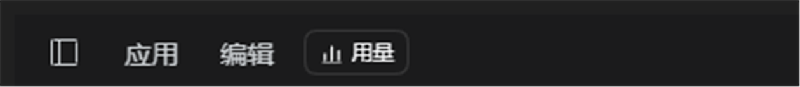

# VDU · View DeepSeek Usage

> 把 <https://platform.deepseek.com/usage> 放进 DeepSeek Harness 的一个**全局浮窗**：顶栏一键打开、切会话不消失、`Ctrl+R` 刷新、快捷键自定义。
>
> A global DeepSeek-usage browser panel for [DeepSeek Harness](https://github.com/deepseek-ai/deepseek-harness): one click in the window title bar, a 16:9 resizable in-app panel that belongs to no session, plus a user-configurable shortcut.



---

## 它解决什么问题

- 用量页在「设置 → 账号与余额」里要看，点好几层；
- 右侧栏「浏览器」是按会话存的（每个 session 一套布局），在会话 A 打开的网页，切到会话 B 就看不到了；
- 想在工作时随时瞄一眼余额 / 消费 / Token，最好是一颗按钮、一个不随会话走的窗口。

这个插件把页面放进 **root 作用域的浮层**（`shell.overlay`），所以它不属于任何会话：
切会话、开新会话、改工作区都不会把它关掉。

## 功能

| 能力 | 说明 |
|---|---|
| 顶栏按钮 | 位于窗口标题栏「应用 / 编辑」右边；左侧栏收起时自动右移，不会和「编辑」重合 |
| 全局面板 | 16:9、约 1200×675、居中；**每次打开都是这个原始尺寸** |
| 移动 | 拖标题栏移动整窗，始终留在窗口内 |
| 拉伸 | 八向把手（四边 + 四角），最小 480×270 |
| 最大化 | 工具栏按钮；最大化时上边让开标题栏，避免压到系统的 最小化/还原/关闭 |
| 关闭 | 点遮罩 / 点窗口外任意处 / `Esc` / 工具栏 × |
| 刷新 | 工具栏刷新按钮，或 `Ctrl+R`（macOS `Cmd+R`） |
| 快捷键 | 默认 `Ctrl+Shift+U`，可在 **设置 → 通用设置 → 编辑快捷键** 里改，冲突自动拦截 |
| 登录态 | 与右侧栏「浏览器」共用同一份 cookie（同一 storage partition），不用重复登录 |

## 安装

### 前置

- DeepSeek Harness **Desktop**（`0.2.1-rc.x`）。纯 Web 没有原生 `<webview>`，面板会说明原因并给出「在系统浏览器中打开」的入口。
- 本插件是「bundle」形态（`package.json` 的 `dsh.bundle.patch`），装进 profile 即生效。

### 方式 A：本地目录

```powershell
# 在 Harness 检出目录里（或任意有 dsh 命令的 shell）
dsh plugin --profile desktop add "D:\path\to\Plugin-VDU_ViewDeepseekUsage"
```

桌面端需要先完全退出再执行（profile 的 package.json 会被加锁）。

### 方式 B：直接从 GitHub

```powershell
dsh plugin --profile desktop add github:<your-name>/Plugin-VDU_ViewDeepseekUsage
```

### 方式 C：手工链接（不想动 package.json 时）

1. 把本目录链接进 profile 的 `node_modules`：

   ```powershell
   cmd /c mklink /J "%USERPROFILE%\.dsh\profiles\desktop\node_modules\dsh-usage-browser" "D:\path\to\Plugin-VDU_ViewDeepseekUsage"
   ```

2. 在 `%USERPROFILE%\.dsh\profiles\desktop\package.json` 的 `dependencies` 里加
   `"dsh-usage-browser": "file:D:/path/to/Plugin-VDU_ViewDeepseekUsage"`，
   在 `dsh.profile.bundles` 里加 `"dsh-usage-browser"`。

装好后重启桌面端；profile 开了 `patchReload: live` 的话，新装 bundle 会直接热生效。

## 使用

1. 点标题栏的 **用量**（或按 `Ctrl+Shift+U`）→ 面板打开，加载 `platform.deepseek.com/usage`；
2. 拖标题栏移动、拖边角拉伸、右上角按钮刷新 / 最大化 / 在系统浏览器打开 / 关闭；
3. 点窗口外或按 `Esc` 关闭；再按一次快捷键也会关掉（开关式）。

### 改快捷键

**设置 → 通用设置 → 编辑快捷键** → 找到 **用户自创 · 用量面板** → 点该行录制新键。

录制时的冲突检测复用应用自带的那套 `describeBinding()`：候选键会和所有已注册命令、
以及固定动作（消息输入 / 菜单与弹层 / 审批区域）比对，撞车就标冲突、不允许保存；
清空绑定（改成「未绑定」）是允许的。

> 关于「用户自创的列」这个分组标题：快捷键面板的分组是写死在外壳里的四组
> （`application / input / menus / approval`），插件注册的命令统一归到 `application`
> 组，**插件 API 没有新增第五个分组标题的能力**。本插件用两个约定让自建命令在
> 列表里连成一片：命令 id 统一 `custom.` 前缀，显示名统一「用户自创 · 」开头。

## 工作原理（给维护者）

### 为什么不是 iframe

`platform.deepseek.com` 的响应头带 `content-security-policy: frame-ancestors 'none'`，
任何 iframe 都会被浏览器拒绝。所以桌面端走宿主自己的浏览器通道：

```js
const carrier = globalThis.dshDesktop            // preload 暴露的产品 API
const bridge = carrier.protocolVersion === 1 ? carrier.browser : undefined
const { lease, partition } = await bridge.acquire(workspaceKey)
const node = document.createElement('webview')
node.setAttribute('name', lease)
node.setAttribute('partition', partition)
node.setAttribute('src', 'about:blank#' + lease)
// 挂上 DOM，等 dom-ready 再 loadURL(url)
```

主进程在 `will-attach-webview` 上校验 lease / partition / src，通过后统一改写
`nodeIntegration:false`、`sandbox:true`、禁用权限与下载——和右侧栏「浏览器」是同一套隔离策略。

### 为什么切会话不会关

- 按钮和面板都渲染在 `shell.overlay`（root 作用域，覆盖整帧）；
- 面板不是会话里的组件，会话切换只换中间的对话，不会卸载它。

### 登录态复用

存储分区键沿用右侧栏浏览器的算法（`cwd:<工作区路径>`，没有工作区就 `session:<id>`），
所以两边共用同一份 cookie。标题栏那颗按钮拿不到当前会话，于是另挂了一个
**零宽度的会话探针**（`conversation.session.header.utilities` 里渲染 `null`），
把当前工作区的分区键同步进插件 store。

### 标题栏定位

`应用 / 编辑` 是窗口自绘标题栏上的菜单（Chromium 画的），没有插槽可注册。
按钮因此绝对定位进标题栏：`top` 按 `--dsh-windows-titlebar-height` 垂直居中，
`left` 落在「编辑」右边缘之后（默认 152px）；左侧栏收起时那一行会多出
「打开侧边栏 + 新建会话」两个图标，菜单整体右移 36px，于是补一条
`[data-sidebar-collapsed]` 规则把按钮挪到 188px。
两个偏移都能用 CSS 变量覆盖，外壳改版时不改逻辑只改数值。

### 键盘：三条路的兜底

`Ctrl+R` 与「唤起快捷键」在不同焦点位置下的投递路径不同，插件都接了：

| 焦点在哪 | 走哪条 |
|---|---|
| 面板自身控件 / 应用界面 | `window` 的 `keydown`（capture） |
| 页面内部（webview 有焦点） | 页面里注入的最小监听：`Ctrl+R → location.reload()` |
| 外壳在主进程拦截按键的构建 | preload 的 `dshDesktop.keyboard` 桥（`kind: keyboard / webview`） |

## 目录结构

```
Plugin-VDU_ViewDeepseekUsage/
├─ package.json          # bundle 清单：dsh.bundle.patch + dsh.client
├─ cordis.patch.yml      # 插入 Host 行 usage-browser
├─ index.js              # Host 半：空 apply()
├─ client.js             # 全部 UI：按钮 / 面板 / webview 生命周期 / 快捷键
├─ locale/
│  ├─ zh.json            # 插件管理里的中文名与说明
│  └─ en.json
├─ icon.svg              # 自绘图标
├─ docs/caption.png      # 截图
├─ LICENSE               # MIT
└─ README.md
```

## 兼容性

- 目标：DeepSeek Harness `>=0.2.1-rc.2 <0.3.0`，Desktop 与 Web 两个 profile；
- 依赖的外壳接口：`dshDesktop.browser`（protocolVersion 1）、`ctx.slots`、
  `ctx.shortcuts`、`conversation.header.leading`、`shell.overlay`、
  `conversation.session.header.utilities`；
- 外壳升级若改了标题栏布局，优先用 CSS 变量 `--dub-caption-left` /
  `--dub-caption-left-collapsed` 校正。

## 已知限制

- 浏览器分区是进程内的，**重启应用后需要重新登录一次**（宿主自带浏览器也是这个行为）；
- 页面里的弹窗会被宿主策略拦下；需要新标签时请用「在系统浏览器中打开」；
- `Esc` 关闭只在焦点位于面板自身控件时可靠（焦点进了页面后按键归 guest）；
  点外部或点 × 始终有效；
- 快捷键的分组标题无法新增（见上文），用 `custom.` 前缀 + 「用户自创 · 」文案替代；
- 标题栏那一行的位置随外壳版本变化，必要时调 CSS 变量。

## License

[MIT](LICENSE)
